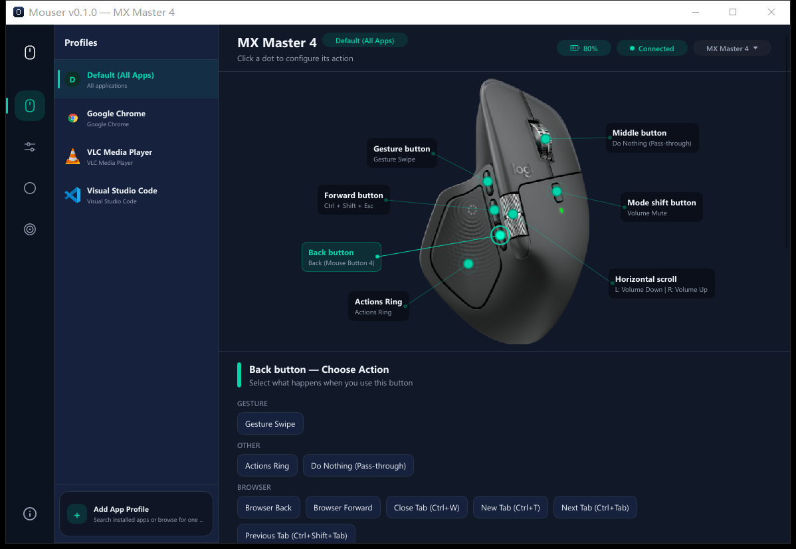
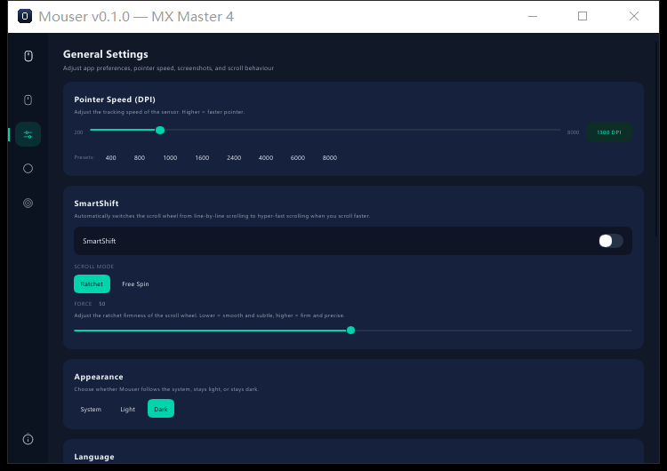

# Mouser (Rust) — Logitech Mouse Remapper

<p align="center">
  
</p>

English | [中文文档](README_CN.md)

A **Rust rewrite** of [Mouser](https://github.com/TomBadash/Mouser), the lightweight,
fully local alternative to **Logitech Options+** for remapping Logitech HID++ mice.
This branch targets **Windows 10/11 (x64)** and focuses on one thing above all:
**a tiny, leak-free background process**.

**No telemetry. No cloud. No Logitech account required.**

> This is the `rust-rewrite` branch of a fork. The Python application lives on
> [`master`](https://github.com/TomBadash/Mouser). Version **0.0.1** is an early
> release: core features are verified on real hardware, some fixes are only
> unit-tested (see [Issue status](#issue-status)).

---

## Contents

- [Why a rewrite](#why-a-rewrite)
- [Memory: before and after](#memory-before-and-after)
- [Download & Run](#download--run)
- [Screenshots](#screenshots)
- [Features](#features)
- [What changed compared with Mouser](#what-changed-compared-with-mouser)
- [Issue status](#issue-status)
- [Build from source](#build-from-source)
- [Limitations](#limitations)
- [Acknowledgments](#acknowledgments)
- [License](#license)

---

## Why a rewrite

Python Mouser runs the mouse hook, the HID++ engine **and** the Qt/QML user interface
in one long-running process, so the whole PySide6 runtime stays in memory all day.

Mouser (Rust) splits it in two:

| Process | Role | Lifetime |
|---|---|---|
| `mouser-agent.exe` | Low-level mouse hook, HID++ device session, tray icon, per-app profiles, Actions Ring overlay, screenshots | Always running, **~2 MB private memory** |
| `mouser-gui.exe` | Settings window (Slint) | Started from the tray, **exits completely when closed** |

They talk over a per-user named pipe (JSON lines). The agent uses plain OS threads,
no async runtime, bounded queues everywhere and no polling timers while idle.
`config.json` stays compatible with Python Mouser (`%APPDATA%\Mouser\config.json`).

---

## Memory: before and after

Measured on the same machine, same mouse, same config, idle in the tray
(`Get-Process`, Private Bytes / Working Set).

| | Python Mouser 3.7.3 | Mouser (Rust) 0.0.1 agent |
|---|---|---|
| Private memory | **90.7 MB** | **2.0 – 2.2 MB** (2.7 MB after a 3 h 42 min run with sleep/lock cycles) |
| Working set | 131 MB | 9.8 – 14.4 MB |
| Handles | 983 | 165 – 230 |
| Threads | 14 | 6 – 9 |
| CPU while idle (60 s) | 78 ms | 0 – 31 ms |
| Executable | Python + PySide6 runtime | 0.8 MB |

On demand: the settings window uses 13 – 20 MB while open and is gone when closed;
the Actions Ring overlay adds ~0.6 MB only while visible; a region screenshot holds
its capture buffer (~30 MB on the test machine) only during selection. All return to idle
afterwards (verified over 600–1000 show/hide cycles: memory, GDI and USER objects flat).

**Test environment**

| | |
|---|---|
| OS | Windows 10 IoT Enterprise LTSC 2021, build 19045, x64 |
| CPU / RAM | Intel Core i5-13500T (14 cores / 20 threads), 32 GB |
| Mouse | Logitech MX Master 2S (WPID 0x4069, HID++ 4.5) on a Unifying receiver (USB 0xC52B) |
| Python Mouser | 3.7.3, commit `b2925920`, Python 3.12, PySide6 6.12 |
| Rust | rustc 1.99.1, x86_64-pc-windows-msvc, release profile (opt-level s, LTO, panic=abort) |

---

## Download & Run

> **No install required.** Download, extract, double-click.

1. Download `mouser-rs-v0.0.1-windows-x64.zip` from the [Releases](../../releases) page.
2. Extract it anywhere (keep `mouser-agent.exe` and `mouser-gui.exe` together).
3. Run `mouser-agent.exe`. A tray icon appears; right-click → **Open Settings**.
4. Verify the download with `SHA256SUMS.txt`.

The executables are not code-signed, so SmartScreen may warn on first run.
Close Python Mouser first: both remap the same buttons.

---

## Screenshots

<p align="center">
  
</p>
<p align="center">
  
  
</p>

---

## Features

### Button remapping
- Remap middle, back, forward, gesture, mode-shift, thumb wheel and DPI buttons
  to keyboard shortcuts, media keys, mouse buttons or custom key combos.
- Gesture button: tap action plus four swipe directions; "Gesture Swipe" on any button.
- **Actions Ring**: hold or tap a button for a radial menu at the cursor.
- **Per-app profiles** switched automatically by the foreground application
  (incl. UWP/Store apps).

### Device control
- DPI with presets, SmartShift (incl. enhanced `0x2111` scroll force),
  native wheel inversion, haptics and force sensitivity (MX Master 4).
- Battery level and connection state.
- **Smooth volume** on the thumb wheel (new, see below).

### Screenshots
- Region / full-screen capture to clipboard or PNG file, multi-monitor, per-monitor DPI.

### Reliability
- Settings are re-applied after the mouse wakes, reconnects, or Windows resumes/unlocks.
- No background HID++ polling while idle, so the PC and the mouse can sleep.
- Hook watchdog, size-capped logs, crash log, one-click diagnostics export (redacted).

### Multi-language UI
English, Simplified Chinese, Traditional Chinese.

### Privacy first
Everything stays local. Diagnostics are written only when you ask, with user name
and paths removed.

---

## What changed compared with Mouser

| Area | Mouser (Python) | Mouser (Rust) |
|---|---|---|
| Architecture | One Qt process | Resident agent + on-demand GUI |
| Platforms | Windows, macOS, Linux | **Windows only** (for now) |
| Thumb-wheel volume | One 2 % step per scroll event, 60 ms cooldown | **Smooth mode** (default): speed-accelerated 2 % steps paced every 8 ms, one sweep covers 0–100 %. Switch back to "Mouser mode" in Settings → Scroll |
| Device polling | Periodic battery/SmartShift polls | Event-driven only |
| Config | `config.json` v11 | Same file and schema; Python Mouser reads it back unchanged (tested with 57 real configs) |
| Auto-update | Built in | Not included yet |

---

## Issue status

Windows issues from the [upstream tracker](https://github.com/TomBadash/Mouser/issues)
that this rewrite addresses. Details and root causes: [`docs/triage/`](docs/triage/README.md).

**Fixed and verified on real hardware (MX Master 2S)**

| Issue | Problem | Fix |
|---|---|---|
| [#342](https://github.com/TomBadash/Mouser/issues/342), [#278](https://github.com/TomBadash/Mouser/issues/278) | DPI lost after lock/unlock | Session unlock re-applies all device settings; DPI read back after unlock |
| [#249](https://github.com/TomBadash/Mouser/issues/249), [#263](https://github.com/TomBadash/Mouser/issues/263) | Settings lost / no effect after the mouse sleeps or the PC resumes | Re-apply on every link-up, reconnect and resume |
| [#205](https://github.com/TomBadash/Mouser/issues/205) | Horizontal scroll from other devices remapped | Wheel events are attributed to the Logitech device via Raw Input (Logitech side verified; a touchpad was not available) |

**Implemented and unit-tested, not yet verified on hardware**

| Issue | Problem |
|---|---|
| [#298](https://github.com/TomBadash/Mouser/issues/298) | SmartShift / horizontal scroll reset after resume |
| [#312](https://github.com/TomBadash/Mouser/issues/312) | MX Master 3S not recognized after reconnect (stale handle) |
| [#255](https://github.com/TomBadash/Mouser/issues/255) | DPI preset / buttons not loaded after restart |
| [#178](https://github.com/TomBadash/Mouser/issues/178), [#209](https://github.com/TomBadash/Mouser/issues/209) | Mouser prevents sleep; language setting not saved |
| [#309](https://github.com/TomBadash/Mouser/issues/309) | Shift + wheel always turned into horizontal scroll (now optional) |
| [#147](https://github.com/TomBadash/Mouser/issues/147), [#129](https://github.com/TomBadash/Mouser/issues/129) | Win+Shift+S and PgUp/PgDn/F-keys cannot be assigned |
| [#156](https://github.com/TomBadash/Mouser/issues/156), [#142](https://github.com/TomBadash/Mouser/issues/142), [#214](https://github.com/TomBadash/Mouser/issues/214) | Wrong device layout behind a shared receiver; MX Anywhere 3 gesture / SmartShift |
| [#327](https://github.com/TomBadash/Mouser/issues/327) | Gesture volume only one step |
| [#257](https://github.com/TomBadash/Mouser/issues/257), [#104](https://github.com/TomBadash/Mouser/issues/104) | Mouser stops working / exits (hook watchdog + persistent log; root cause unconfirmed) |
| [#116](https://github.com/TomBadash/Mouser/issues/116), [#281](https://github.com/TomBadash/Mouser/issues/281), [#270](https://github.com/TomBadash/Mouser/issues/270) | Elevated foreground apps (UIPI) and admin requirement — needs a non-elevated test run |

**Not fixed**

| Issue | Reason |
|---|---|
| [#149](https://github.com/TomBadash/Mouser/issues/149) | Ctrl+Alt+Del is the Secure Attention Sequence; user-mode programs cannot send it (now rejected with a message) |
| [#271](https://github.com/TomBadash/Mouser/issues/271), [#231](https://github.com/TomBadash/Mouser/issues/231) | Need more information from the reporters (device data / logs) |
| [#219](https://github.com/TomBadash/Mouser/issues/219), [#233](https://github.com/TomBadash/Mouser/issues/233), [#314](https://github.com/TomBadash/Mouser/issues/314) and other macOS / Linux issues | This branch is Windows only (the memory reports are macOS; on Windows see [Memory](#memory-before-and-after)) |

---

## Build from source

Requirements: Windows 10/11 x64, [Rust](https://rustup.rs) (stable, MSVC toolchain),
Visual Studio 2022 Build Tools with the C++ workload and Windows SDK.

```powershell
git clone -b rust-rewrite https://github.com/YZ-SI/Mouser.git
cd Mouser
cargo build --release
# Package exes + SHA256SUMS into dist\
powershell -File scripts\release.ps1
```

Run the tests: `cargo test --workspace`.

| Crate | Purpose |
|---|---|
| `mouser-core` | Config (schema v11 + migrations), device catalog, gestures, key registry, IPC protocol |
| `mouser-hidpp` | HID++ 1.0/2.0 over hidapi: discovery, diverts, DPI, SmartShift, battery, haptics |
| `mouser-win` | WH_MOUSE_LL hook, SendInput, foreground app, start at login, screenshots |
| `mouser-agent` | The resident agent: engine, tray, named pipe, Actions Ring, region overlay |
| `mouser-gui` | Slint settings window |

---

## Limitations

- Windows x64 only; no installer, no auto-update, binaries not signed.
- Only the MX Master 2S was tested on real hardware; other devices rely on the catalog ported from Mouser.
- Not yet tested: Explorer restart, logoff/shutdown, non-elevated agent with elevated apps, non-ASCII paths, 24 h soak.

---

## Acknowledgments

- **[Mouser](https://github.com/TomBadash/Mouser)** by Tom Badash and all its contributors — the behavior,
  device catalog, layouts, images and icon this rewrite follows.
- **[OpenLogi](https://github.com/AprilNEA/OpenLogi)** by AprilNEA — Rust reference for HID++ and device data.
- **[Slint](https://slint.dev)** — the settings window UI toolkit.

---

## License

MIT, same as Mouser. See [LICENSE](LICENSE) and [NOTICE](NOTICE).

**Mouser** is not affiliated with or endorsed by Logitech. "Logitech", "MX Master", and "Options+" are trademarks of Logitech International S.A.
