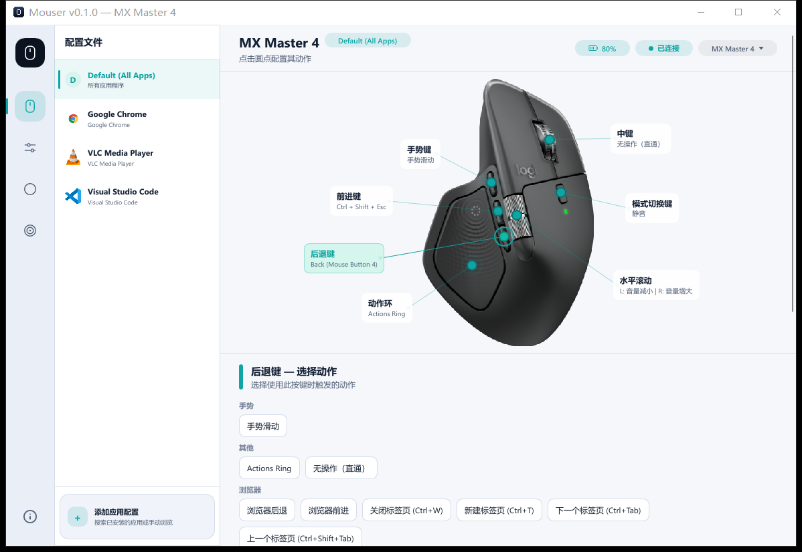
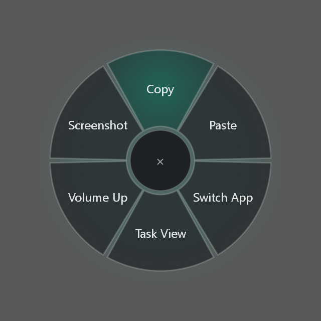
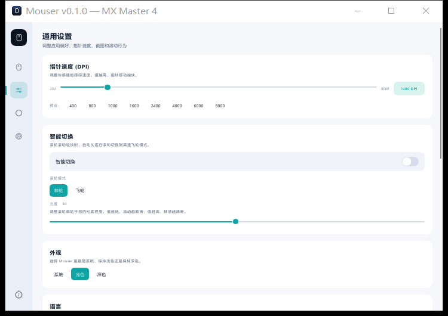

# Mouser (Rust) — 罗技鼠标按键映射工具

<p align="center">
  
</p>

[English](README.md) | 中文文档

这是 [Mouser](https://github.com/TomBadash/Mouser) 的 **Rust 重写版**。Mouser 是一款轻量、完全本地运行的
**Logitech Options+** 替代工具，用于重映射罗技 HID++ 鼠标。本分支面向 **Windows 10/11（x64）**，
首要目标是：**极小、不泄漏的常驻后台进程**。

**无遥测，无云端，无需罗技账号。**

> 这是一个 fork 的 `rust-rewrite` 分支。Python 版本在
> [`master`](https://github.com/TomBadash/Mouser)。**0.0.1** 是早期版本：核心功能已在真机上验证，
> 部分修复目前只有单元测试（见[问题修复情况](#问题修复情况)）。

---

## 目录

- [为什么重写](#为什么重写)
- [内存占用：重写前后对比](#内存占用重写前后对比)
- [下载与运行](#下载与运行)
- [截图](#截图)
- [功能](#功能)
- [与 Mouser 的区别](#与-mouser-的区别)
- [问题修复情况](#问题修复情况)
- [从源码构建](#从源码构建)
- [已知限制](#已知限制)
- [致谢](#致谢)
- [许可证](#许可证)

---

## 为什么重写

Python 版 Mouser 把鼠标钩子、HID++ 引擎**和** Qt/QML 界面放在同一个常驻进程里，整个 PySide6
运行时全天都占着内存。

Mouser (Rust) 拆成两个进程：

| 进程 | 职责 | 生命周期 |
|---|---|---|
| `mouser-agent.exe` | 低级鼠标钩子、HID++ 设备会话、托盘、按应用配置、Actions Ring 浮层、截图 | 常驻，**私有内存约 2 MB** |
| `mouser-gui.exe` | 设置窗口（Slint） | 从托盘打开，**关闭后进程完全退出** |

两者通过按用户隔离的命名管道通信（JSON 行）。后台只用系统线程，不用异步运行时，
所有队列都有上限，空闲时没有轮询定时器。`config.json` 与 Python 版 Mouser 保持兼容
（`%APPDATA%\Mouser\config.json`）。

---

## 内存占用：重写前后对比

同一台机器、同一只鼠标、同一份配置，在托盘中空闲时测量（`Get-Process`，私有字节 / 工作集）。

| | Python Mouser 3.7.3 | Mouser (Rust) 0.0.1 后台 |
|---|---|---|
| 私有内存 | **90.7 MB** | **2.0 – 2.2 MB**（连续运行 3 小时 42 分、经历睡眠与锁屏后为 2.7 MB） |
| 工作集 | 131 MB | 9.8 – 14.4 MB |
| 句柄数 | 983 | 165 – 230 |
| 线程数 | 14 | 6 – 9 |
| 空闲 60 秒 CPU 时间 | 78 ms | 0 – 31 ms |
| 可执行文件 | Python + PySide6 运行时 | 0.8 MB |

按需占用：设置窗口打开时约 13 – 20 MB，关闭即释放；Actions Ring 浮层仅在显示时多占约 0.6 MB；
区域截图仅在框选期间持有截图缓冲（测试机上约 30 MB）。结束后都会回到空闲水平
（经 600 – 1000 次显示/隐藏循环验证，内存、GDI 与 USER 对象均无增长）。

**测试环境**

| | |
|---|---|
| 系统 | Windows 10 IoT 企业版 LTSC 2021，build 19045，x64 |
| CPU / 内存 | Intel Core i5-13500T（14 核 / 20 线程），32 GB |
| 鼠标 | Logitech MX Master 2S（WPID 0x4069，HID++ 4.5），Unifying 接收器（USB 0xC52B） |
| Python Mouser | 3.7.3，提交 `b2925920`，Python 3.12，PySide6 6.12 |
| Rust | rustc 1.99.1，x86_64-pc-windows-msvc，release 配置（opt-level s、LTO、panic=abort） |

---

## 下载与运行

> **无需安装。** 下载、解压、双击即可。

1. 在 [Releases](../../releases) 页面下载 `mouser-rs-v0.0.1-windows-x64.zip`。
2. 解压到任意位置（`mouser-agent.exe` 和 `mouser-gui.exe` 要放在一起）。
3. 运行 `mouser-agent.exe`，托盘出现图标后右键 → **打开设置**。
4. 可用 `SHA256SUMS.txt` 校验下载文件。

可执行文件没有代码签名，首次运行时 SmartScreen 可能提示。
请先关闭 Python 版 Mouser，两者会接管同样的按键。

---

## 截图

<p align="center">
  
</p>
<p align="center">
  
  
</p>

---

## 功能

### 按键重映射
- 中键、后退、前进、手势键、模式切换键、拇指滚轮、DPI 键均可映射为快捷键、媒体键、鼠标按键或自定义组合键。
- 手势键：单击动作 + 上下左右四个滑动方向；任意按键都可设为"手势滑动"。
- **Actions Ring**：按住或单击按键，在光标处弹出环形菜单。
- **按应用自动切换配置**（包括 UWP / 商店应用）。

### 设备控制
- DPI 及预设、SmartShift（含增强版 `0x2111` 滚轮阻尼）、原生滚轮反向、触觉反馈与力度灵敏度（MX Master 4）。
- 电量与连接状态。
- 拇指滚轮**丝滑调音量**（新增，见下文）。

### 截图
- 区域 / 全屏截图，可复制到剪贴板或保存为 PNG，支持多显示器和每显示器 DPI。

### 可靠性
- 鼠标唤醒、重连，或 Windows 从睡眠恢复 / 解锁后，自动重新应用设置。
- 空闲时不做 HID++ 轮询，电脑和鼠标都能正常休眠。
- 钩子看门狗、限制大小的日志、崩溃日志、一键导出诊断包（已脱敏）。

### 多语言界面
英文、简体中文、繁体中文。

### 隐私优先
一切都在本地。诊断包只在你主动导出时生成，并去掉用户名和路径。

---

## 与 Mouser 的区别

| 方面 | Mouser（Python） | Mouser (Rust) |
|---|---|---|
| 架构 | 单个 Qt 进程 | 常驻后台 + 按需设置窗口 |
| 平台 | Windows、macOS、Linux | **目前仅 Windows** |
| 拇指滚轮调音量 | 每个滚动事件调 2%，60 ms 冷却 | **丝滑模式**（默认）：按滚动速度加速的 2% 步进，每 8 ms 发一步，快速滚一次可覆盖 0–100%。可在 设置 → 滚动 中切回"Mouser 模式" |
| 设备轮询 | 定时轮询电量 / SmartShift | 只由事件驱动 |
| 配置 | `config.json` v11 | 同一文件、同一格式；Python 版可原样读回（用 57 份真实配置测试） |
| 自动更新 | 内置 | 暂未包含 |

---

## 问题修复情况

以下是本重写处理的[上游问题](https://github.com/TomBadash/Mouser/issues)中与 Windows 相关的部分。
根因分析与详情见 [`docs/triage/`](docs/triage/README.md)。

**已修复，并在真机（MX Master 2S）上验证**

| 问题 | 现象 | 修复 |
|---|---|---|
| [#342](https://github.com/TomBadash/Mouser/issues/342)、[#278](https://github.com/TomBadash/Mouser/issues/278) | 锁屏 / 解锁后 DPI 丢失 | 解锁后重新写入全部设备设置，并读回 DPI 确认 |
| [#249](https://github.com/TomBadash/Mouser/issues/249)、[#263](https://github.com/TomBadash/Mouser/issues/263) | 鼠标休眠或电脑唤醒后设置丢失 / 失效 | 每次连上、重连、唤醒都重新应用 |
| [#205](https://github.com/TomBadash/Mouser/issues/205) | 其他设备的横向滚动也被重映射 | 用 Raw Input 判断滚动来自罗技设备（已验证罗技一侧；测试机没有触摸板） |

**已实现并有单元测试，尚未在真机上验证**

| 问题 | 现象 |
|---|---|
| [#298](https://github.com/TomBadash/Mouser/issues/298) | 唤醒后 SmartShift / 横向滚动被重置 |
| [#312](https://github.com/TomBadash/Mouser/issues/312) | MX Master 3S 重连后无法识别（句柄失效） |
| [#255](https://github.com/TomBadash/Mouser/issues/255) | 重启后 DPI 预设 / 按键设置未加载 |
| [#178](https://github.com/TomBadash/Mouser/issues/178)、[#209](https://github.com/TomBadash/Mouser/issues/209) | 阻止系统休眠；语言设置没保存 |
| [#309](https://github.com/TomBadash/Mouser/issues/309) | Shift + 滚轮总被转成横向滚动（现在可关闭） |
| [#147](https://github.com/TomBadash/Mouser/issues/147)、[#129](https://github.com/TomBadash/Mouser/issues/129) | 无法设置 Win+Shift+S、PgUp/PgDn/F 键 |
| [#156](https://github.com/TomBadash/Mouser/issues/156)、[#142](https://github.com/TomBadash/Mouser/issues/142)、[#214](https://github.com/TomBadash/Mouser/issues/214) | 共享接收器下设备布局识别错误；MX Anywhere 3 手势键 / SmartShift |
| [#327](https://github.com/TomBadash/Mouser/issues/327) | 手势调音量只能调一格 |
| [#257](https://github.com/TomBadash/Mouser/issues/257)、[#104](https://github.com/TomBadash/Mouser/issues/104) | 运行一段时间后失效 / 退出（已加钩子看门狗和持久日志，根因未确认） |
| [#116](https://github.com/TomBadash/Mouser/issues/116)、[#281](https://github.com/TomBadash/Mouser/issues/281)、[#270](https://github.com/TomBadash/Mouser/issues/270) | 前台为管理员程序时（UIPI）的问题、需要管理员才能启动——需要在非管理员环境测试 |

**未修复**

| 问题 | 原因 |
|---|---|
| [#149](https://github.com/TomBadash/Mouser/issues/149) | Ctrl+Alt+Del 是系统安全键（SAS），普通程序无法模拟（现在会给出提示并拒绝） |
| [#271](https://github.com/TomBadash/Mouser/issues/271)、[#231](https://github.com/TomBadash/Mouser/issues/231) | 需要报告者提供更多信息（设备数据 / 日志） |
| [#219](https://github.com/TomBadash/Mouser/issues/219)、[#233](https://github.com/TomBadash/Mouser/issues/233)、[#314](https://github.com/TomBadash/Mouser/issues/314) 等 macOS / Linux 问题 | 本分支只支持 Windows（内存问题报告来自 macOS；Windows 上的情况见[内存对比](#内存占用重写前后对比)） |

---

## 从源码构建

需要：Windows 10/11 x64、[Rust](https://rustup.rs)（stable，MSVC 工具链）、
Visual Studio 2022 Build Tools（C++ 工作负载与 Windows SDK）。

```powershell
git clone -b rust-rewrite https://github.com/YZ-SI/Mouser.git
cd Mouser
cargo build --release
# 打包 exe 与 SHA256SUMS 到 dist\
powershell -File scripts\release.ps1
```

运行测试：`cargo test --workspace`。

| Crate | 用途 |
|---|---|
| `mouser-core` | 配置（v11 格式与迁移）、设备目录、手势、按键表、IPC 协议 |
| `mouser-hidpp` | 基于 hidapi 的 HID++ 1.0/2.0：特性发现、按键转发、DPI、SmartShift、电量、触觉 |
| `mouser-win` | WH_MOUSE_LL 钩子、SendInput、前台应用检测、开机自启、截图 |
| `mouser-agent` | 常驻后台：引擎、托盘、命名管道、Actions Ring、区域截图浮层 |
| `mouser-gui` | Slint 设置窗口 |

---

## 已知限制

- 仅支持 Windows x64；没有安装包、没有自动更新，可执行文件未签名。
- 真机只测试了 MX Master 2S；其他设备依赖从 Mouser 移植的设备目录。
- 尚未测试：资源管理器重启、注销 / 关机、非管理员后台配合管理员程序、非 ASCII 路径、24 小时长时间运行。

---

## 致谢

- **[Mouser](https://github.com/TomBadash/Mouser)**（Tom Badash 及全体贡献者）——本重写所遵循的行为、设备目录、布局、图片和图标都来自它。
- **[OpenLogi](https://github.com/AprilNEA/OpenLogi)**（AprilNEA）——HID++ 与设备数据的 Rust 参考实现。
- **[Slint](https://slint.dev)**——设置窗口所用的界面框架。

---

## 许可证

与 Mouser 相同，采用 MIT 许可证。见 [LICENSE](LICENSE) 与 [NOTICE](NOTICE)。

**Mouser** 与罗技（Logitech）没有任何关联，也未获其认可。"Logitech"、"MX Master" 和 "Options+" 是 Logitech International S.A. 的商标。
